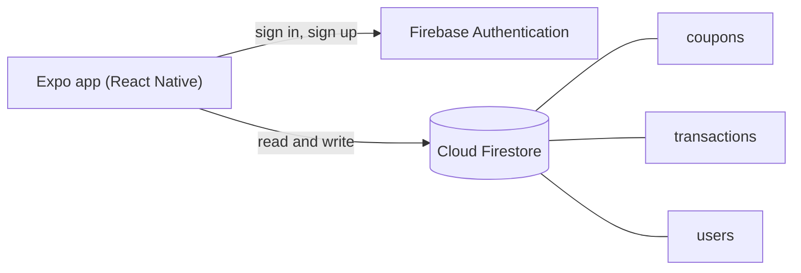
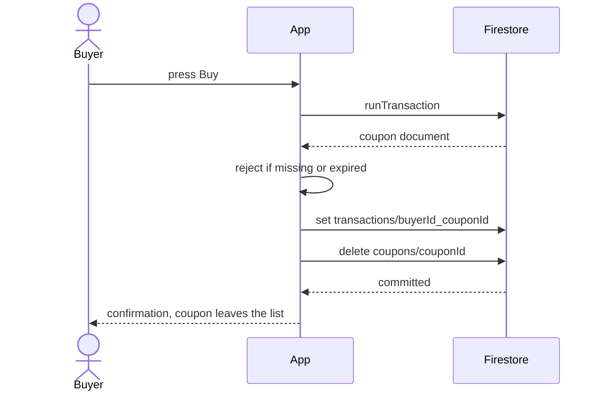

<h1 align="center">Cash Your Coupons</h1>

<p align="center">
  A mobile marketplace to sell, buy and find exchange matches for unused coupons.<br>
  List a coupon with its value and expiry, and other signed-in users can buy it before it expires.
</p>

<p align="center">
  <a href="#try-it-live">Try it</a>
  &middot;
  <a href="#how-it-works">How it works</a>
  &middot;
  <a href="#run-it-locally">Run locally</a>
  &middot;
  <a href="#environment-variables">Settings</a>
</p>

<p align="center">
  
  
  
  
</p>

<p align="center"><sub>Last updated: 2026-10-17 &middot; Baseline: the Android bundle builds and lint is clean (checked 2026-10-17); not yet run on a device, no hosted version</sub></p>

---

## Contents

- [About](#about)
- [Try it live](#try-it-live)
- [Features](#features)
- [Why it exists](#why-it-exists)
- [How it works](#how-it-works)
- [Engineering quality](#engineering-quality)
- [Run it locally](#run-it-locally)
- [Environment variables](#environment-variables)
- [Deployment](#deployment)
- [Status and roadmap](#status-and-roadmap)
- [Credits](#credits)

## About

Gift cards, promo codes and vouchers often expire unused because the person who got them has no
use for them. Cash Your Coupons lets that person list the coupon with a price and an expiry date,
and lets someone else buy it, so the value is used instead of lost.

Accounts, listings and purchase records live in Firebase (Authentication and Firestore); the app
is a React Native client built with Expo.

## Try it live

Not deployed yet: this is a mobile app, and a store or preview build needs an Expo account and a
device build (see [Deployment](#deployment)). Follow [Run it locally](#run-it-locally) to bundle it,
and see [Status and roadmap](#status-and-roadmap) for what is checked.

Once it runs on a device or emulator:

1. Create an account on the login screen with an email and password.
2. Open **Sell**, fill in the name, value, details, category and expiry date, and list a coupon.
3. Sign in as a second user: the coupon appears under **Buy**, filtered by expiry (expired, this week, this month).
4. Press buy: the purchase is recorded and the coupon leaves the list.
5. Open **Exchange**, enter a category and price, and see other users' coupons that match.

## Features

- **Email and password accounts**: sign up and sign in with Firebase Authentication.
  - The session is kept between launches with AsyncStorage.
- **Sell**: list a coupon with name, value, details, category and expiry date.
  - Categories: Food, Clothes, Travel and others from the picker.
  - Expiry is chosen with a date picker.
- **Buy**: browse other users' listings, sorted by soonest expiry, with search and filters.
  - Your own listings are not shown to you.
  - A purchase runs as one Firestore transaction: it fails if the coupon is gone or expired.
- **Exchange**: search other users' coupons by category or price.
- **Profile**: your details, your listings and your transactions, and sign out.

## Why it exists

A university project to build a complete mobile app against a real backend: authentication,
a shared database, several screens and a purchase that must not sell the same coupon twice. It
taught navigation in React Native and why a purchase belongs in a transaction.

## How it works



What happens when a user buys a coupon (`BuyCouponsScreen`):



The read, the expiry check, the purchase record and the delete are one transaction, so two buyers
cannot both get the same coupon.

### Tech stack

| Layer | Technology |
|---|---|
| App | React Native 0.76 with Expo 52, React 18 |
| Navigation | React Navigation 7 (stack and bottom tabs) |
| Backend | Firebase Authentication and Cloud Firestore (Firebase JS SDK 11) |
| Quality | ESLint with the Expo config, an Android bundle check |
| Toolchain | Node 22, pinned in `mise.toml` |

### Design decisions

1. **Firebase instead of an own backend.** Auth, database and real-time rules with no server to run. Trade-off: the access rules live in the Firebase console, not in this repository, and the client does the business logic.
2. **The purchase is a transaction.** It re-reads the coupon, checks expiry and deletes it atomically. Trade-off: the coupon is deleted on purchase, so there is no history of the listing itself, only the transaction record.
3. **All Firebase settings from environment variables.** `config.js` reads `EXPO_PUBLIC_*` values and fails on startup with the list of missing ones. Trade-off: Expo inlines them into the app, so they are public (they identify the project; Firestore rules and Authentication protect the data).

<details>
<summary><strong>Project structure</strong></summary>

```
App.js              navigation: login stack and the four tabs
firebase.js         Firebase app, Auth (persisted) and Firestore
config.js           Firebase settings from environment variables
screens/            Login, Buy, Sell, Exchange, Profile
android/            native Android project (for a development build)
mise.toml           Node version pin
.env.example        every setting with a comment
```

</details>

## Engineering quality

| Area | What is in place |
|---|---|
| Lint | ESLint (Expo config) clean of errors on 2026-10-17; two hook-dependency warnings remain |
| Build check | `npm run check` lints and bundles the Android app with Hermes; passed on 2026-10-17 |
| Firebase project | on 2026-10-17 a read-only probe showed the project answers and refuses unauthenticated reads of `coupons` |
| Secrets | none in the repository; Firebase settings come from the environment |
| Not covered | no automated tests, no CI, no run on a device yet, dependency audit not clean (see below) |

Run the checks:

```bash
npm run lint
npm run check
```

## Run it locally

Works on Windows (Git Bash), macOS and Linux. You need **Node 22** (`mise.toml` pins it; [mise](https://mise.jdx.dev) installs it, or install Node 22 yourself) and a Firebase project of your own with Email/Password sign-in and Firestore enabled.

```bash
git clone https://github.com/A-RYAN-1/cash-your-coupons.git
cd cash-your-coupons
mise install
mise exec -- npm ci
cp .env.example .env              # then put your Firebase web app settings in .env
set -a; . ./.env; set +a          # Git Bash and Linux; see the note below for PowerShell
mise exec -- npm run check        # lint plus an Android bundle; no device needed
mise exec -- npx expo start       # then open it in a development build
```

The app includes `expo-dev-client`, so it runs in a **development build** (`npx expo run:android` with
the Android SDK installed, or an EAS development build), not in the store version of Expo Go,
which only opens the newest Expo SDK.

<details>
<summary><strong>Common problems</strong></summary>

- `Missing Firebase settings: apiKey, ...`: the variables are not in the environment; load `.env` as shown above before `expo start`.
- `Firebase: Error (auth/invalid-credential)`: wrong email or password, or the account does not exist in your Firebase project.
- `permission-denied` on the Buy or Sell screen: your Firestore security rules do not allow signed-in users to read and write `coupons`.
- `The query requires an index`: the Buy screen filters on `userId` and `type`; open the link in the error to create the index in the Firebase console.

</details>

## Environment variables

| Variable | What it is | Needed |
|---|---|---|
| `EXPO_PUBLIC_FIREBASE_API_KEY` | web API key of your Firebase app | always |
| `EXPO_PUBLIC_FIREBASE_AUTH_DOMAIN` | `<project>.firebaseapp.com` | always |
| `EXPO_PUBLIC_FIREBASE_PROJECT_ID` | Firebase project id | always |
| `EXPO_PUBLIC_FIREBASE_STORAGE_BUCKET` | storage bucket name | always (unused by the screens today) |
| `EXPO_PUBLIC_FIREBASE_MESSAGING_SENDER_ID` | sender id | always |
| `EXPO_PUBLIC_FIREBASE_APP_ID` | app id | always |

They are found in the Firebase console under Project settings, Your apps. They are not secrets (the
client SDK needs them and Expo inlines them), but they are kept out of the code and configured per
environment. Never commit a real `.env` file; only `.env.example` is tracked.

## Deployment

Not deployed yet. The backend is a Firebase project (Authentication and Firestore on the free Spark
plan). The app has no hosted version: it needs a development build (EAS Build free tier or a local
Android build) or a move to a newer Expo SDK so that Expo Go can open it. Planned hosts: Firebase
for the backend, EAS for builds.

## Status and roadmap

**Reached:** the project installs and bundles on this laptop (2026-10-17): `npm run check` passes,
and the Firebase project is reachable and refuses unauthenticated reads. **Not reached:** a run on a
device or emulator, which needs a development build.

**Known limitations**

- The Firestore security rules are not in this repository, so who may read or write which documents is not reviewable here.
- The Exchange screen only searches for matching coupons; it does not carry out an exchange.
- A coupon has no redeemable code field: the app lists and transfers the listing, not the voucher itself.
- Buying deletes the coupon document, so a listing leaves no history besides the transaction record.
- `npm audit` reports high-severity findings in transitive dependencies of Expo and Firebase; not fixed in the baseline.
- No automated tests and no CI; two lint hook-dependency warnings.

**Planned**

- [ ] Export the Firestore rules into the repository and tighten them (owner-only edits).
- [ ] A development build (EAS) so the app can be run and screenshotted on a device.
- [ ] Tests for the buy transaction against the Firestore emulator, and CI.
- [ ] Make Exchange create an exchange offer.

## Credits

Built by [Aryan Deshmukh](https://github.com/A-RYAN-1) as a university project (2025); the baseline
(environment configuration, lint, build check, this README) was done in October 2026.
