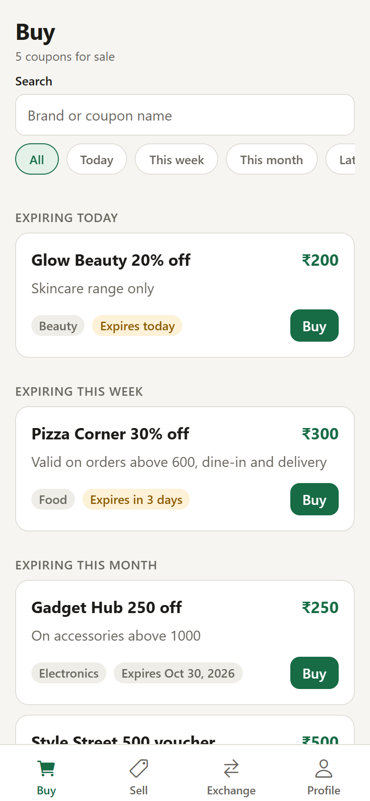
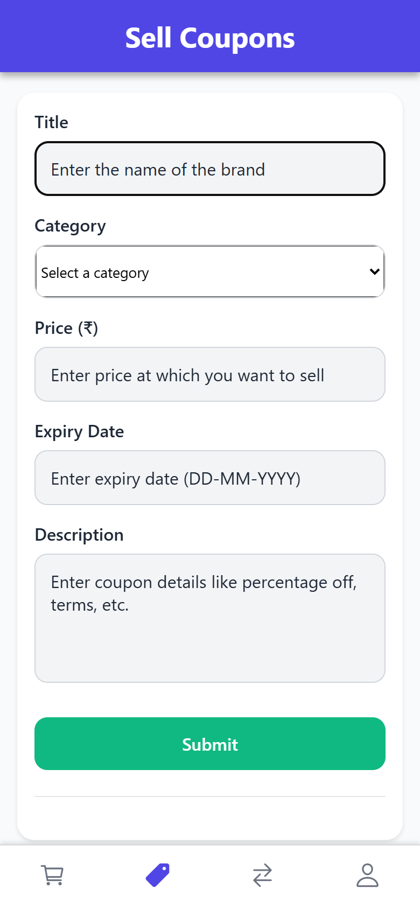
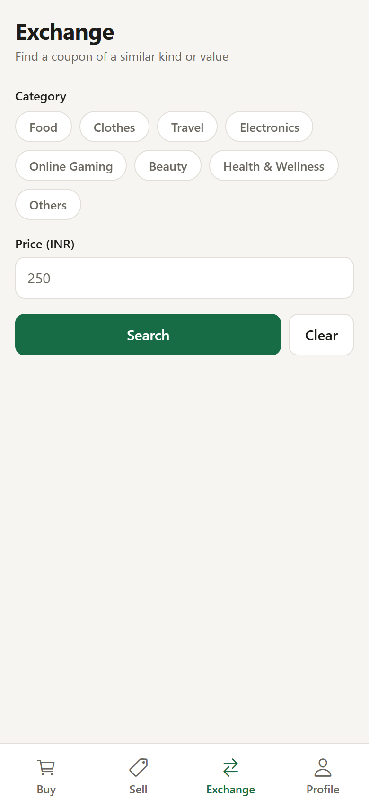
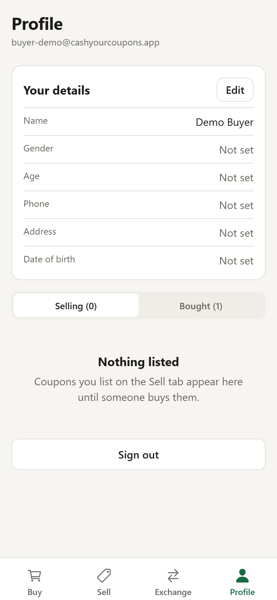
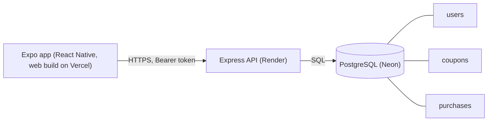
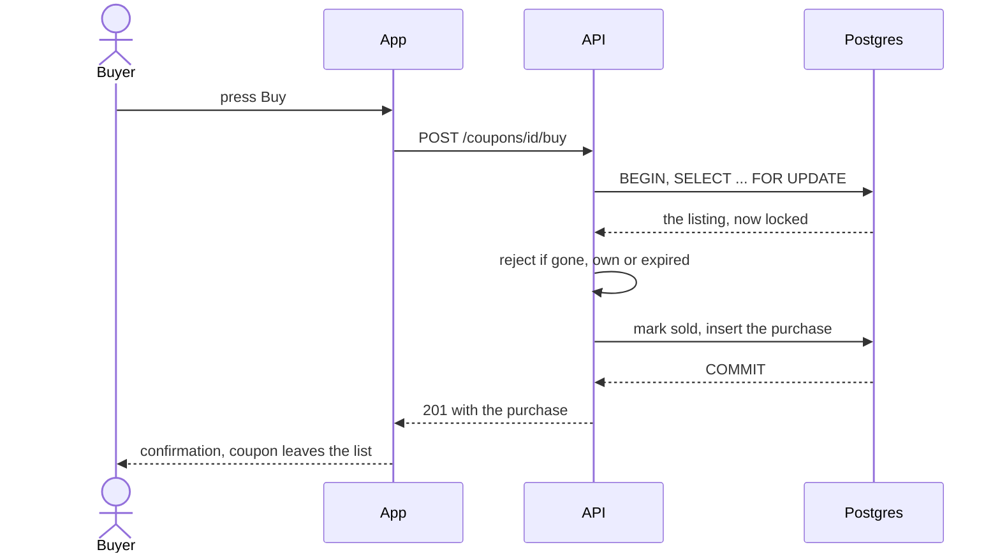

<h1 align="center">Cash Your Coupons</h1>

<p align="center">
  A mobile marketplace to sell, buy and find exchange matches for unused coupons.<br>
  List a coupon with its value and expiry, and other signed-in users can buy it before it expires.
</p>

<p align="center">
  <a href="https://cash-your-coupons.vercel.app"><strong>Live demo</strong></a>
  &middot;
  <a href="#try-it-live">Demo login</a>
  &middot;
  <a href="#how-it-works">How it works</a>
  &middot;
  <a href="#run-it-locally">Run locally</a>
  &middot;
  <a href="#environment-variables">Settings</a>
</p>

<p align="center">
  
  
  
  
  
  
  
</p>

<p align="center">
  <a href="https://cash-your-coupons.vercel.app">
    
  </a>
</p>

<p align="center"><sub>Last updated: 2026-10-18 &middot; Live on free tiers (Vercel for the web build, Render for the API, Neon for Postgres); also runs in Expo Go</sub></p>

---

## Contents

- [About](#about)
- [Try it live](#try-it-live)
- [Features](#features)
- [Why it exists](#why-it-exists)
- [How it works](#how-it-works)
- [Engineering quality](#engineering-quality)
- [Run it locally](#run-it-locally)
- [Environment variables](#environment-variables)
- [Deployment](#deployment)
- [Status and roadmap](#status-and-roadmap)
- [Credits](#credits)

## About

Gift cards, promo codes and vouchers often expire unused because the person who got them has no
use for them. Cash Your Coupons lets that person list the coupon with a price and an expiry date,
and lets someone else buy it, so the value is used instead of lost.

Accounts, listings and purchase records live in PostgreSQL behind an Express API (`server/`); the app
is a React Native client built with Expo that talks to it through one small module (`api.js`).

## Try it live

Open **https://cash-your-coupons.vercel.app** and sign in with the public demo account:

| Email | Password |
|---|---|
| `buyer-demo@cashyourcoupons.app` | `demo-pass-123` |

It is a shared demo: anyone can sign in, and a purchase removes that coupon for everyone until the
demo data is reset (see [Run it locally](#run-it-locally), `npm run seed` in `server/`). The first request after the API has been idle can take about a minute, because the free Render plan sleeps. Things to try
in the first two minutes:

1. On **Buy**, see five coupons from a demo seller grouped by how soon they expire, and use the search box and the filter.
2. Press **Buy** on one: the purchase is recorded and the coupon leaves the list.
3. Open **Profile**: your details, and the coupon you bought under "Coupons Bought".
4. Open **Sell** to see the listing form (title, category, price, expiry as DD-MM-YYYY, description).
5. Open **Exchange**, enter a category such as Food or a price, and search other users' coupons.

<table>
  <tr>
    <td width="50%"><p align="center"><sub>Buy: listings sorted by soonest expiry (<a href="#how-it-works">how a purchase works</a>)</sub></p></td>
    <td width="50%"><p align="center"><sub>Sell: list a coupon (<a href="#features">features</a>)</sub></p></td>
  </tr>
  <tr>
    <td width="50%"><p align="center"><sub>Exchange: find matching coupons (<a href="#status-and-roadmap">limits</a>)</sub></p></td>
    <td width="50%"><p align="center"><sub>Profile: details, listings, purchases (<a href="#features">features</a>)</sub></p></td>
  </tr>
</table>

<p align="center"><sub>Screenshots are of the web build running the production code against the demo accounts.</sub></p>

## Features

- **Email and password accounts**: sign up and sign in; passwords are hashed with bcrypt and a signed login token is kept on the device (AsyncStorage), so a reload stays signed in.
- **Sell**: list a coupon with name, value, details, category and expiry date.
  - Categories: Food, Clothes, Travel and others from the picker.
  - Expiry is chosen with a date picker.
- **Buy**: browse other users' listings, sorted by soonest expiry, with search and filters.
  - Your own listings are not shown to you.
  - A purchase is one database transaction that locks the listing: it fails if the coupon is gone, expired or your own, and two buyers racing for one coupon cannot both win.
- **Exchange**: search other users' coupons by category or price.
- **Profile**: your details, your listings (each can be withdrawn after a confirmation), your purchases, and sign out.

## Why it exists

A university project to build a complete mobile app against a real backend: authentication,
a shared database, several screens and a purchase that must not sell the same coupon twice. It
started on Firebase and was moved to its own API in October 2026, so the access rules live in code
that is tested here instead of in a console that cannot be reviewed.

## How it works



What happens when a user buys a coupon (`POST /coupons/:id/buy`):



The row lock makes the check and the sale one step, and the purchase table's unique `coupon_id`
is a second guard, so two buyers cannot both get the same coupon.

### Tech stack

| Layer | Technology |
|---|---|
| App | React Native 0.88 with Expo 58, React 19; runs on Android, iOS and the web (react-native-web) |
| Navigation | React Navigation 7 (stack and bottom tabs) |
| API | Node 22, Express 4, `pg`, bcrypt, JWT, helmet, express-rate-limit |
| Database | PostgreSQL 18 on Neon (free), schema in `server/database.sql` applied by `npm run migrate` |
| Quality | ESLint and Prettier, 25 API tests against real Postgres, `expo-doctor`, Android and web bundle check, GitHub Actions CI |
| Hosting | Vercel (web build), Render free web service (API), Neon (database) |
| Toolchain | Node 22, pinned in `mise.toml` |

### Design decisions

1. **An own API instead of Firebase.** Rules, validation and the purchase transaction are code in this repository, with tests, and a new feature never waits on a console. Trade-off: a server to host, which on the free plan sleeps after 15 minutes idle.
2. **The purchase is a locked transaction.** The listing row is locked, checked, marked sold and the purchase recorded in one step. Sold and withdrawn listings stay in the table, so there is history.
3. **One codebase for phone and browser.** `api.js` is the only network module, the session token is kept in AsyncStorage on every platform, and `notify.js` replaces `Alert` and `confirm`, which differ on the web. Trade-off: the token lives in storage the app can read, not an httpOnly cookie; acceptable for a demo, a gap to close for real money.
4. **Settings from environment variables.** The app reads `EXPO_PUBLIC_API_URL` (public by design) and fails on startup if it is missing; the API reads its secrets from its own environment and refuses to start without them.

<details>
<summary><strong>Project structure</strong></summary>

```
App.js              navigation: login stack or the four tabs, chosen by the saved session
api.js              every call to the API and the saved login token
config.js           the API address from EXPO_PUBLIC_API_URL
notify.js           alert and confirm for native and web
screens/            Login, Buy, Sell, Exchange, Profile
server/             the API: app.js (routes), validation.js, database.sql, seed.js, test/
compose.yaml        a local Postgres for the API and its tests
render.yaml         Render blueprint for the API
vercel.json         build and output settings for the web deploy
mise.toml           Node version pin
.env.example        the app's setting; server/.env.example the API's
```

</details>

## Engineering quality

| Area | What is in place |
|---|---|
| API tests | 25 tests (`server/test`) on real Postgres: validation, auth, ownership, withdraw, the buy transaction including a race for one coupon; pass on 2026-10-18 |
| Lint and format | ESLint (app and API) clean of errors, Prettier clean on the API, 2026-10-18; two hook-dependency warnings remain in the app |
| Build check | `npm run check` (lint, `expo-doctor`, Android Hermes and web bundles) passed on 2026-10-18 |
| Browser run | on 2026-10-18 the live site was driven in Chrome (Playwright): a wrong password refused, the Buy list, a purchase (the coupon left the list and showed under Profile), a reload that kept the session, and a seller withdrawing a listing |
| Security | bcrypt passwords, signed expiring tokens, helmet, CORS limited to the web origin, rate limit on login and register, JSON errors without stack traces, parameterised SQL; `npm audit --omit=dev` found 0 in the API on 2026-10-18 |
| CI | GitHub Actions runs the API job (lint, format, migrate, tests, audit) and the app job (lint, `expo-doctor`, web export) on every push |
| Monitoring and scanning | an Uptime workflow pings the API `/health` and the app every 30 minutes, CodeQL scans on every push and weekly, and Dependabot opens weekly version-update pull requests (workflows added 2026-10-20) |
| Not covered | no screen tests, not run on a physical phone |

Run the checks:

```bash
npm run lint && npm run check          # the app (set EXPO_PUBLIC_API_URL first)
cd server && npm run lint && npm test  # the API (needs the local Postgres below)
```

## Run it locally

Works on Windows (Git Bash), macOS and Linux. You need **Node 22** (`mise.toml` pins it; [mise](https://mise.jdx.dev) installs it, or install Node 22 yourself) and **Docker** for the local database.

```bash
git clone https://github.com/A-RYAN-1/cash-your-coupons.git
cd cash-your-coupons
mise install
docker compose up -d db                 # Postgres on localhost:5433

cd server
mise exec -- npm ci
cp .env.example .env                    # the defaults work with the compose database
mise exec -- npm run migrate            # creates the tables
mise exec -- npm run seed               # demo accounts and five coupons
mise exec -- npm start                  # API on http://localhost:5000
mise exec -- npm test                   # optional: the API tests

cd ..                                   # the app, in a second terminal
mise exec -- npm ci
cp .env.example .env                    # EXPO_PUBLIC_API_URL points at localhost:5000
set -a; . ./.env; set +a                # Git Bash and Linux; in PowerShell set $env:EXPO_PUBLIC_API_URL
mise exec -- npm run web                # open it in the browser
mise exec -- npx expo start             # or scan the QR code with Expo Go (use your computer's address instead of localhost)
```

The project is on Expo SDK 58, the version the store's Expo Go opens, so no native build or Android
SDK is needed. When Expo Go moves on to a newer SDK, upgrade with `npx expo install expo@latest --fix`.

<details>
<summary><strong>Common problems</strong></summary>

- `Missing EXPO_PUBLIC_API_URL`: the variable is not in the environment; load `.env` as shown above before `expo start`.
- `Cannot reach the server`: the API is not running (or, on the live site, is waking up; wait a minute and retry). On a phone, `localhost` is the phone, so use your computer's network address in `EXPO_PUBLIC_API_URL` and add the web origin to `CORS_ORIGINS` if you test in a browser.
- `Missing required environment variable DATABASE_URL`: copy `server/.env.example` to `server/.env`.
- `connect ECONNREFUSED 127.0.0.1:5433`: the database is not up; run `docker compose up -d db`.

</details>

## Environment variables

**App** (`.env`):

| Variable | What it is | Needed |
|---|---|---|
| `EXPO_PUBLIC_API_URL` | address of the API, no trailing slash | always |

**API** (`server/.env`, see `server/.env.example`):

| Variable | What it is | Needed |
|---|---|---|
| `DATABASE_URL` | Postgres connection string | always |
| `JWT_SECRET` | random string of 32 or more characters that signs login tokens | always |
| `JWT_EXPIRES_IN` | how long a login lasts, default `7d` | optional |
| `PORT` | port to listen on, default 5000 (Render sets it) | optional |
| `CORS_ORIGINS` | comma-separated web origins allowed to call the API | when a browser app is hosted elsewhere |
| `DATABASE_SSL` | `true` for a database that needs TLS (Neon) | hosted |

The app's address is public (the browser calls it). The API's secrets stay in its host's
environment. Never commit a real `.env`; only the `.env.example` files are tracked.

## Deployment

The web build is live at **https://cash-your-coupons.vercel.app** on Vercel Hobby (free). It calls
the API at **https://cash-your-coupons-api.onrender.com** (Render free web service, Singapore), which
uses a Neon Postgres database (free, Singapore). Phones use Expo Go against the same API.

| Part | Host | Deploys | Settings the host needs |
|---|---|---|---|
| Web build | Vercel project `cash-your-coupons` (Git-linked to this repo) | on every push to `main`: `npm ci`, then `npx expo export --platform web --output-dir dist` (`vercel.json`) | `EXPO_PUBLIC_API_URL` for Production and Preview |
| API | Render web service `cash-your-coupons-api` (`render.yaml`, root `server`) | on every push to `main`: `npm ci && npm run migrate`, then `npm start`; health check `/health` | `DATABASE_URL`, `JWT_SECRET`, `CORS_ORIGINS`, `DATABASE_SSL` |
| Database | Neon project `cash-your-coupons-db` | schema applied by `npm run migrate` on every API deploy | n/a |

Free-tier limits a visitor notices (checked 2026-10-18): the API sleeps after 15 minutes without
traffic and the first request takes about a minute to wake it; Neon Free allows 1 GB and 100
compute-hours a month, far above a demo.

<details>
<summary><strong>Recreate the deploy from nothing</strong></summary>

1. Create a Neon Postgres database; copy its connection string.
2. On Render, create a free Node web service from this repo with root directory `server`, build `npm ci && npm run migrate`, start `npm start`, and the four API settings above.
3. On Vercel, import the repo, set `EXPO_PUBLIC_API_URL` to the Render URL for Production and Preview, and deploy.
4. Run `npm run seed` in `server/` with the database variables to create the demo accounts.

</details>

## Status and roadmap

**Reached:** live on free tiers (2026-10-18) on an own API and database; the live site was exercised end to end in a browser (sign in, browse, buy, profile, reload, withdraw); 25 API tests and CI. **Not reached:** a run on a physical phone.

**Known limitations**

- The login token is kept in app storage, not an httpOnly cookie, and there is no password reset or email check.
- The Exchange screen only searches for matching coupons; it does not carry out an exchange.
- A coupon has no redeemable code field: the app lists and transfers the listing, not the voucher itself.
- Money is not handled: a purchase marks the coupon sold, with no payment.
- `npm audit` reports high-severity findings in transitive dependencies of Expo for the app (the API is clean); not fixed yet.
- No screen tests; two lint hook-dependency warnings.

**Planned**

- [x] Move off Firebase to an own API with tests (2026-10-18).
- [x] Let a seller withdraw a listing (2026-10-18).
- [x] An uptime check on `/health`, CodeQL and Dependabot (2026-10-20).
- [ ] Lighthouse accessibility and performance pass.
- [ ] Make Exchange create an exchange offer.

## Credits

Built by [Aryan Deshmukh](https://github.com/A-RYAN-1) as a university project (2025); the baseline
(environment configuration, lint, build check, this README) was done in October 2026.
