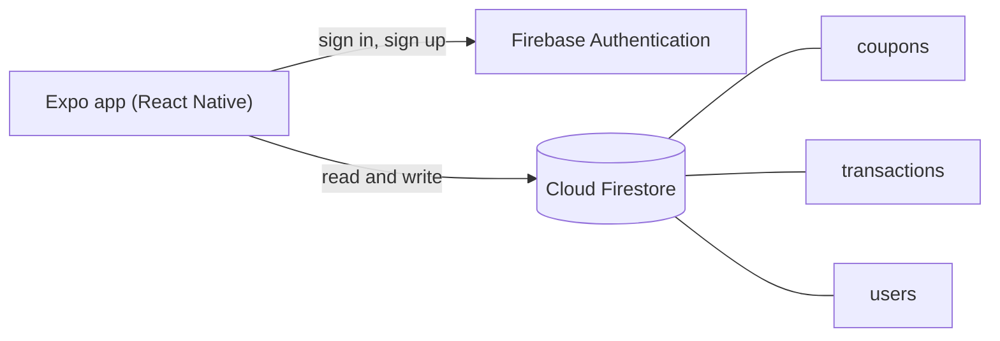
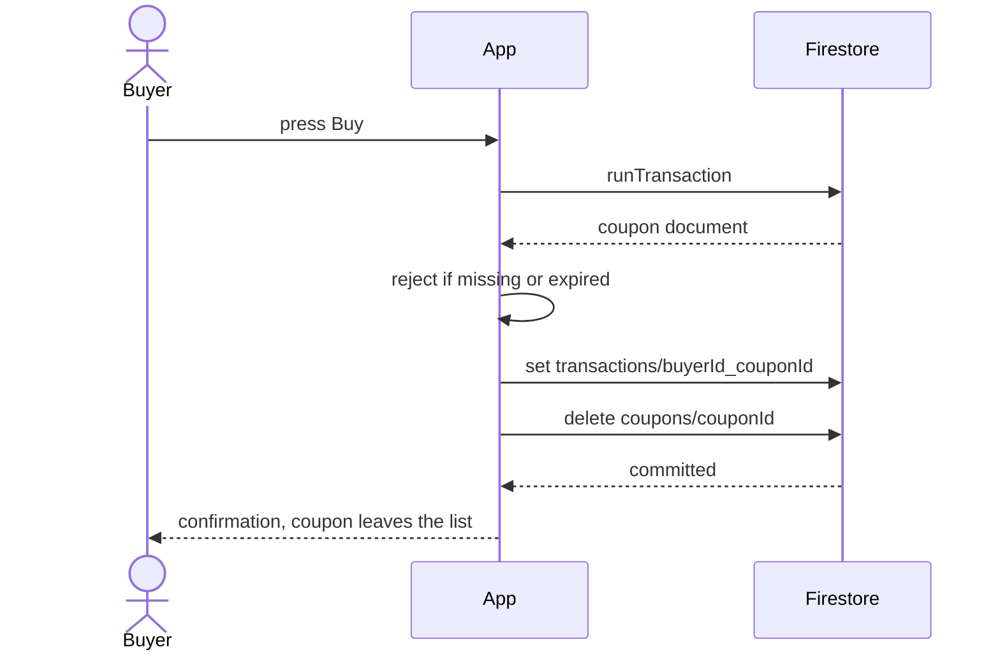

<h1 align="center">Cash Your Coupons</h1>

<p align="center">
  A mobile marketplace to sell, buy and find exchange matches for unused coupons.<br>
  List a coupon with its value and expiry, and other signed-in users can buy it before it expires.
</p>

<p align="center">
  <a href="https://cash-your-coupons.vercel.app"><strong>Live demo</strong></a>
  &middot;
  <a href="#try-it-live">Demo login</a>
  &middot;
  <a href="#how-it-works">How it works</a>
  &middot;
  <a href="#run-it-locally">Run locally</a>
  &middot;
  <a href="#environment-variables">Settings</a>
</p>

<p align="center">
  
  
  
  
  
</p>

<p align="center">
  <a href="https://cash-your-coupons.vercel.app">
    
  </a>
</p>

<p align="center"><sub>Last updated: 2026-10-17 &middot; Live on free tiers (Vercel for the web build, Firebase for the backend); also runs in Expo Go</sub></p>

---

## Contents

- [About](#about)
- [Try it live](#try-it-live)
- [Features](#features)
- [Why it exists](#why-it-exists)
- [How it works](#how-it-works)
- [Engineering quality](#engineering-quality)
- [Run it locally](#run-it-locally)
- [Environment variables](#environment-variables)
- [Deployment](#deployment)
- [Status and roadmap](#status-and-roadmap)
- [Credits](#credits)

## About

Gift cards, promo codes and vouchers often expire unused because the person who got them has no
use for them. Cash Your Coupons lets that person list the coupon with a price and an expiry date,
and lets someone else buy it, so the value is used instead of lost.

Accounts, listings and purchase records live in Firebase (Authentication and Firestore); the app
is a React Native client built with Expo.

## Try it live

Open **https://cash-your-coupons.vercel.app** and sign in with the public demo account:

| Email | Password |
|---|---|
| `buyer-demo@cashyourcoupons.app` | `demo-pass-123` |

It is a shared demo: anyone can sign in, and a purchase removes that coupon for everyone until the
demo data is reset (see [Run it locally](#run-it-locally), `scripts/seed-demo.mjs`). Things to try
in the first two minutes:

1. On **Buy**, see five coupons from a demo seller grouped by how soon they expire, and use the search box and the filter.
2. Press **Buy** on one: the purchase is recorded and the coupon leaves the list.
3. Open **Profile**: your details, and the coupon you bought under "Coupons Bought".
4. Open **Sell** to see the listing form (title, category, price, expiry as DD-MM-YYYY, description).
5. Open **Exchange**, enter a category such as Food or a price, and search other users' coupons.

<table>
  <tr>
    <td width="50%"><p align="center"><sub>Buy: listings sorted by soonest expiry (<a href="#how-it-works">how a purchase works</a>)</sub></p></td>
    <td width="50%"><p align="center"><sub>Sell: list a coupon (<a href="#features">features</a>)</sub></p></td>
  </tr>
  <tr>
    <td width="50%"><p align="center"><sub>Exchange: find matching coupons (<a href="#status-and-roadmap">limits</a>)</sub></p></td>
    <td width="50%"><p align="center"><sub>Profile: details, listings, purchases (<a href="#features">features</a>)</sub></p></td>
  </tr>
</table>

<p align="center"><sub>Screenshots are of the web build running the production code against the demo accounts.</sub></p>

## Features

- **Email and password accounts**: sign up and sign in with Firebase Authentication.
  - The session is kept between launches with AsyncStorage.
- **Sell**: list a coupon with name, value, details, category and expiry date.
  - Categories: Food, Clothes, Travel and others from the picker.
  - Expiry is chosen with a date picker.
- **Buy**: browse other users' listings, sorted by soonest expiry, with search and filters.
  - Your own listings are not shown to you.
  - A purchase runs as one Firestore transaction: it fails if the coupon is gone or expired.
- **Exchange**: search other users' coupons by category or price.
- **Profile**: your details, your listings and your transactions, and sign out.

## Why it exists

A university project to build a complete mobile app against a real backend: authentication,
a shared database, several screens and a purchase that must not sell the same coupon twice. It
taught navigation in React Native and why a purchase belongs in a transaction.

## How it works



What happens when a user buys a coupon (`BuyCouponsScreen`):



The read, the expiry check, the purchase record and the delete are one transaction, so two buyers
cannot both get the same coupon.

### Tech stack

| Layer | Technology |
|---|---|
| App | React Native 0.88 with Expo 58, React 19; runs on Android, iOS and the web (react-native-web) |
| Navigation | React Navigation 7 (stack and bottom tabs) |
| Backend | Firebase Authentication and Cloud Firestore (Firebase JS SDK 11) |
| Quality | ESLint with the Expo config, `expo-doctor`, Android and web bundle check |
| Hosting | Vercel (web build) and Firebase (Authentication, Firestore) |
| Toolchain | Node 22, pinned in `mise.toml` |

### Design decisions

1. **Firebase instead of an own backend.** Auth, database and real-time rules with no server to run. Trade-off: the access rules live in the Firebase console, not in this repository, and the client does the business logic.
2. **The purchase is a transaction.** It re-reads the coupon, checks expiry and deletes it atomically. Trade-off: the coupon is deleted on purchase, so there is no history of the listing itself, only the transaction record.
3. **One codebase for phone and browser.** `firebase.js` (native, session kept in AsyncStorage) and `firebase.web.js` (browser SDK) are picked per platform by Metro, and `notify.js` replaces `Alert`, which does nothing on the web. Trade-off: two small platform files to keep in step.
4. **All Firebase settings from environment variables.** `config.js` reads `EXPO_PUBLIC_*` values and fails on startup with the list of missing ones. Trade-off: Expo inlines them into the app, so they are public (they identify the project; Firestore rules and Authentication protect the data).

<details>
<summary><strong>Project structure</strong></summary>

```
App.js              navigation: login stack and the four tabs
firebase.js         Firebase app, Auth (persisted) and Firestore, native
firebase.web.js     the same for the browser build
scripts/seed-demo.mjs  creates the demo accounts and coupons
vercel.json         build and output settings for the web deploy
config.js           Firebase settings from environment variables
notify.js           one alert function for native and web
screens/            Login, Buy, Sell, Exchange, Profile
mise.toml           Node version pin
.env.example        every setting with a comment
```

</details>

## Engineering quality

| Area | What is in place |
|---|---|
| Lint | ESLint (Expo config) clean of errors on 2026-10-17; two hook-dependency warnings remain |
| Build check | `npm run check` runs lint, `expo-doctor` (20 of 20 checks) and exports the Android (Hermes) and web bundles; passed on 2026-10-17 |
| Browser run | on 2026-10-17 the live site was driven in Chrome (Playwright): sign in, the Buy list, a purchase as one Firestore transaction (the coupon left the list and showed under Profile), and all four tabs; a wrong login showed `auth/invalid-credential` |
| Firebase project | on 2026-10-17 a read-only probe showed the project answers and refuses unauthenticated reads of `coupons` |
| Secrets | none in the repository; Firebase settings come from the environment |
| Not covered | no automated tests, no CI, not run on a physical phone, dependency audit not clean (see below) |

Run the checks:

```bash
npm run lint
npm run check
```

## Run it locally

Works on Windows (Git Bash), macOS and Linux. You need **Node 22** (`mise.toml` pins it; [mise](https://mise.jdx.dev) installs it, or install Node 22 yourself) and a Firebase project of your own with Email/Password sign-in and Firestore enabled.

```bash
git clone https://github.com/A-RYAN-1/cash-your-coupons.git
cd cash-your-coupons
mise install
mise exec -- npm ci
cp .env.example .env              # then put your Firebase web app settings in .env
set -a; . ./.env; set +a          # Git Bash and Linux; in PowerShell set each variable with $env:NAME="value"
mise exec -- npm run check        # lint, expo-doctor, Android and web bundles; no device needed
mise exec -- npx expo start       # scan the QR code with Expo Go on your phone
mise exec -- npm run web          # or open it in the browser
```

To fill your own Firebase project with the demo accounts and coupons: `node scripts/seed-demo.mjs` (with the variables loaded). It never deletes; it adds the coupons that are missing.

The project is on Expo SDK 58, the version the store's Expo Go opens, so no native build or Android
SDK is needed. When Expo Go moves on to a newer SDK, upgrade with `npx expo install expo@latest --fix`.

<details>
<summary><strong>Common problems</strong></summary>

- `Missing Firebase settings: apiKey, ...`: the variables are not in the environment; load `.env` as shown above before `expo start`.
- `Firebase: Error (auth/invalid-credential)`: wrong email or password, or the account does not exist in your Firebase project.
- `permission-denied` on the Buy or Sell screen: your Firestore security rules do not allow signed-in users to read and write `coupons`.
- `The query requires an index`: the Buy screen filters on `userId` and `type`; open the link in the error to create the index in the Firebase console.

</details>

## Environment variables

| Variable | What it is | Needed |
|---|---|---|
| `EXPO_PUBLIC_FIREBASE_API_KEY` | web API key of your Firebase app | always |
| `EXPO_PUBLIC_FIREBASE_AUTH_DOMAIN` | `<project>.firebaseapp.com` | always |
| `EXPO_PUBLIC_FIREBASE_PROJECT_ID` | Firebase project id | always |
| `EXPO_PUBLIC_FIREBASE_STORAGE_BUCKET` | storage bucket name | always (unused by the screens today) |
| `EXPO_PUBLIC_FIREBASE_MESSAGING_SENDER_ID` | sender id | always |
| `EXPO_PUBLIC_FIREBASE_APP_ID` | app id | always |

They are found in the Firebase console under Project settings, Your apps. They are not secrets (the
client SDK needs them and Expo inlines them), but they are kept out of the code and configured per
environment. Never commit a real `.env` file; only `.env.example` is tracked.

## Deployment

The web build is live at **https://cash-your-coupons.vercel.app** on Vercel Hobby (free), and the
backend is a Firebase project (Authentication and Firestore, free Spark plan). Phones use Expo Go
against the same backend.

| Part | Host | Deploys | Variables the host needs |
|---|---|---|---|
| Web build | Vercel project `cash-your-coupons` (Git-linked to this repo) | on every push to `main`: `npm ci`, then `npx expo export --platform web --output-dir dist` (`vercel.json`) | the six `EXPO_PUBLIC_FIREBASE_*` variables, set for Production and Preview (the API key as a "config" variable, since it is public) |
| Backend | Firebase (Spark plan) | managed in the Firebase console | n/a |

Free-tier limits a visitor notices (checked 2026-10-17): none for this demo; Firebase Spark has daily
read and write quotas, which a demo does not reach.

<details>
<summary><strong>Recreate the Vercel deploy from nothing</strong></summary>

1. `vercel link --yes --project cash-your-coupons`, then delete the `.env.local` it creates.
2. Add each `EXPO_PUBLIC_FIREBASE_*` variable for production and preview (`vercel env add NAME production`; for the API key add `--type config`).
3. `vercel deploy --prod`, then `vercel git connect` so pushes deploy.

</details>

## Status and roadmap

**Reached:** live on free tiers (2026-10-17). Upgraded from Expo 52 to 58, `npm run check` passes, and the live site was exercised end to end as the demo buyer (sign in, browse, buy, profile). Firestore refuses unauthenticated reads. **Not reached:** a run on a physical phone.

**Known limitations**

- The Firestore security rules are not in this repository, so who may read or write which documents is not reviewable here.
- A seller cannot delete a listing: the Firestore rules (set in the console, not in this repository) refuse it, so a listing can only leave by being bought.
- The Exchange screen only searches for matching coupons; it does not carry out an exchange.
- A coupon has no redeemable code field: the app lists and transfers the listing, not the voucher itself.
- Buying deletes the coupon document, so a listing leaves no history besides the transaction record.
- `npm audit` reports high-severity findings in transitive dependencies of Expo and Firebase; not fixed in the baseline.
- No automated tests and no CI; two lint hook-dependency warnings.

**Planned**

- [ ] Export the Firestore rules into the repository and tighten them (owner-only edits).
- [ ] Let a seller withdraw a listing (rules and a button).
- [ ] Tests for the buy transaction against the Firestore emulator, and CI.
- [ ] Make Exchange create an exchange offer.

## Credits

Built by [Aryan Deshmukh](https://github.com/A-RYAN-1) as a university project (2025); the baseline
(environment configuration, lint, build check, this README) was done in October 2026.
